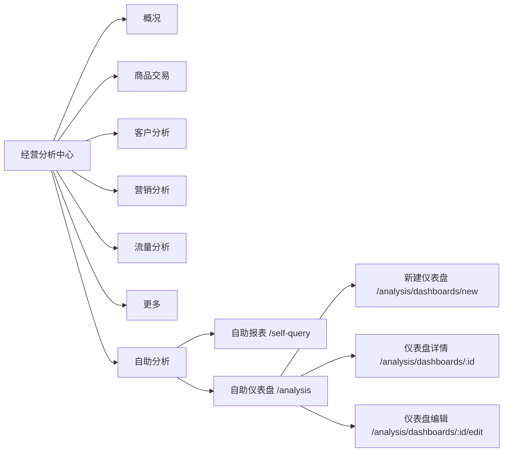
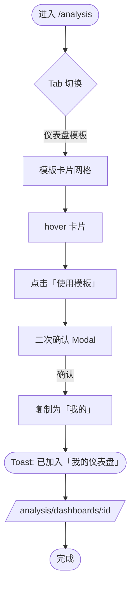
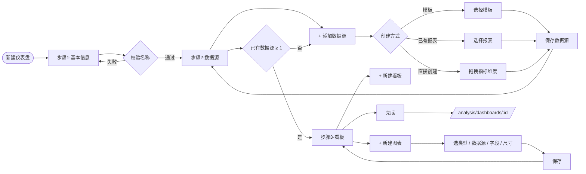
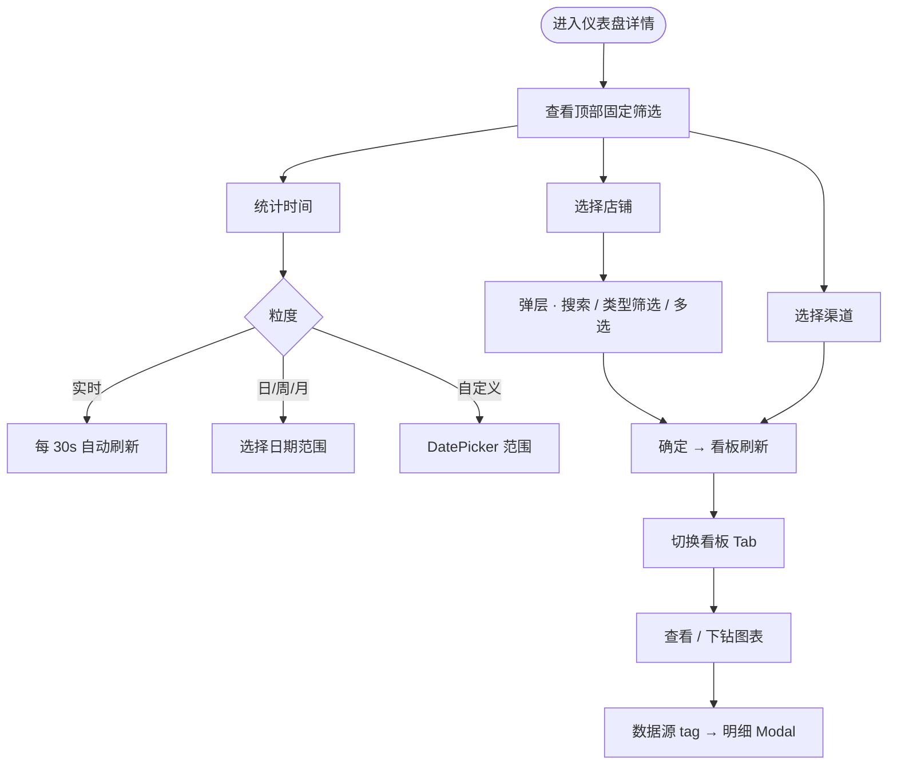
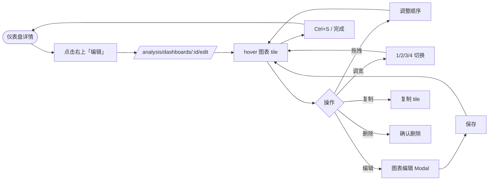
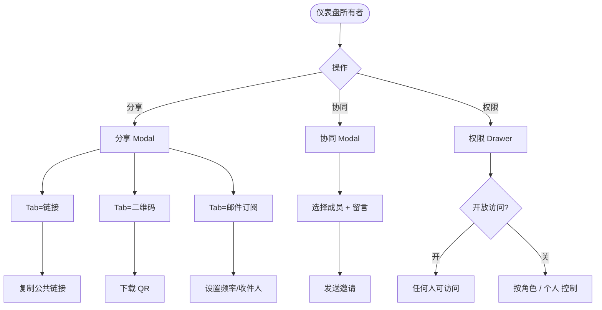
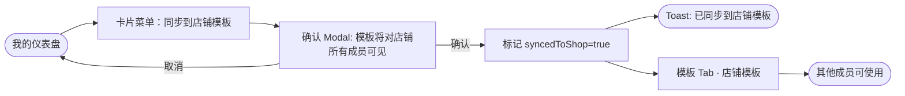
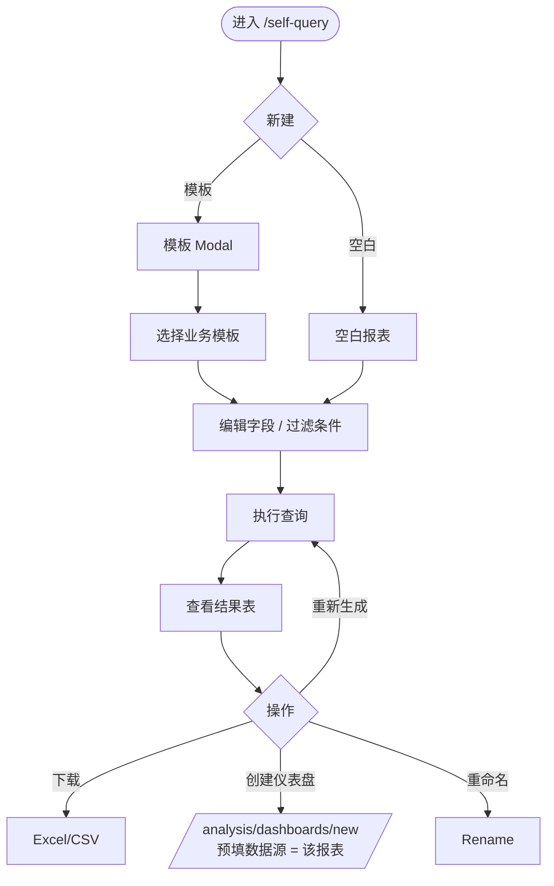
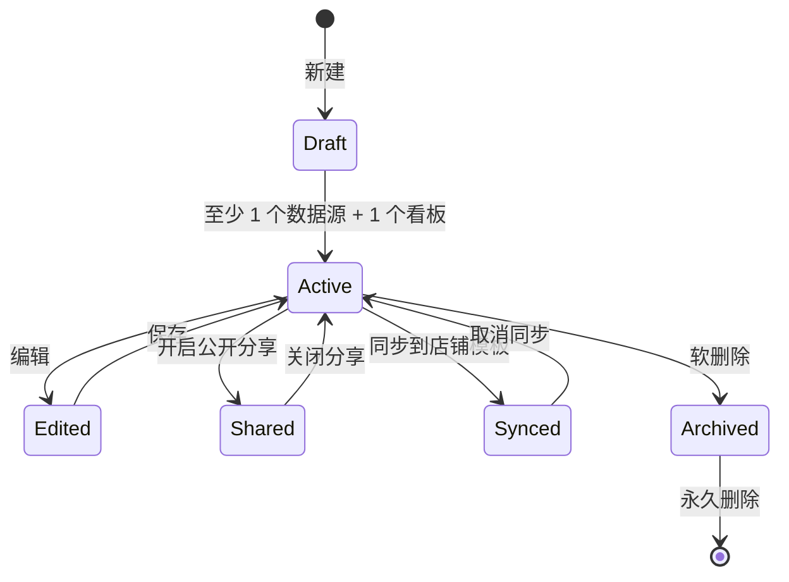

# 用户流程图 · 经营分析中心 · 自助分析

> 用 Mermaid 画 7 条核心流程，可直接粘贴到 Notion / Lark / FigJam（FigJam 支持 Mermaid 导入）。

## 信息架构

---

## 流程 1 · 通过模板创建仪表盘

---

## 流程 2 · 从零创建仪表盘（三步式）

---

## 流程 3 · 仪表盘查看与筛选

---

## 流程 4 · 编辑已有仪表盘的图表

---

## 流程 5 · 分享 / 协同 / 权限

---

## 流程 6 · 同步到店铺仪表盘模板

---

## 流程 7 · 自助报表 → 转为仪表盘数据源

---

## 状态转换 · 仪表盘生命周期

