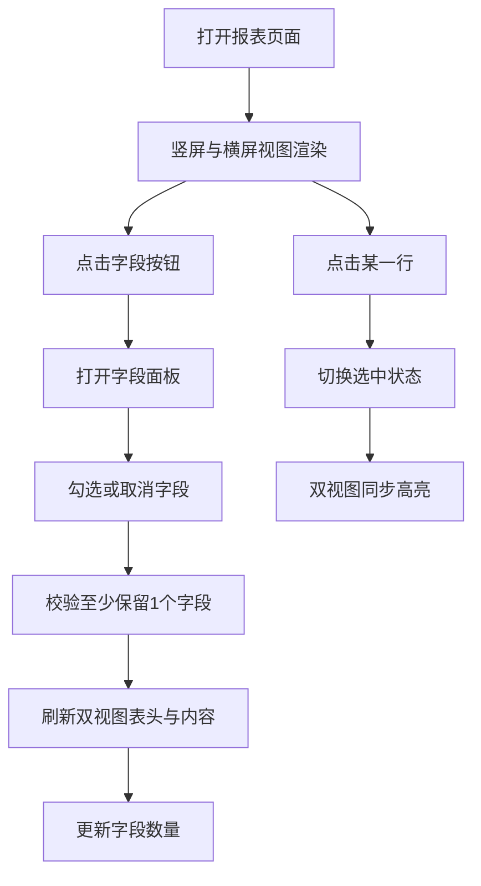

# 报表原型详细需求文档

## 1. 文档目标
- 基于当前最终版原型，明确移动端报表页面的功能需求与交互细节。
- 输出可用于产品评审、设计对齐、前后端开发与测试验收的统一基线。

## 2. 适用范围
- 终端：H5/App 内嵌页面（以 iPhone 视觉为主）。
- 展示形态：竖屏与横屏双预览（同一数据源、同一交互状态）。
- 页面对象：`店铺业绩报表(销售单元)-周报`。

## 3. 页面结构需求

### 3.1 全局布局
- 页面包含两个设备视图：
  - 竖屏视图（iPhone 外壳）
  - 横屏视图（iPhone 外壳）
- 两个视图同时展示，视觉风格一致。
- 两个视图共享同一套字段配置与行选中状态。

### 3.2 顶部区域
- 顶栏包含：返回符号、页面标题`有赞智能报表`、更多操作符号。
- 环境条显示：`YZ测试-连锁-标准版`。
- 报表标题区显示：
  - 标题：`店铺业绩报表(销售单元)-周报`
  - 统计时间：`2026-04-21 至 2026-04-21`
  - 操作区：`字段(数量)` 按钮 + `设置` 按钮

### 3.3 表格区域
- 表头固定（sticky）。
- 内容区支持纵向滚动。
- 表格支持横向滚动以容纳多字段。
- 单元格具备分割线与统一对齐风格。

## 4. 功能需求

### FR-01 字段选择（多选）
- 在`设置`左侧提供`字段(数量)`入口。
- 点击后弹出字段面板。
- 面板列出全部可选字段，支持多选。
- 选中/取消后，表格列实时更新。
- 字段数量实时回显在按钮文案中，例如`字段(6)`。
- 约束：至少保留 1 个字段（不可全部取消）。

### FR-02 行点击高亮
- 用户点击任意数据行时，该行进入高亮状态。
- 再次点击同一行时，取消高亮（切换逻辑）。
- 同一时刻仅允许 1 行高亮。
- 竖屏与横屏视图需同步高亮同一行。

### FR-03 双视图状态同步
- 字段显示状态在竖屏/横屏双向同步。
- 行选中状态在竖屏/横屏双向同步。
- 任一视图触发操作，另一视图应立即反映。

### FR-04 数据展示
- 默认展示字段（基于当前原型）：
  - 店铺名称
  - 营业收入(不含赠送金)
  - 笔单价
  - 分店店铺ID
  - 合伙人名称
  - 经营模式
  - 品类目
  - 支付笔数
  - 实付金额
  - 营业额
- 支持字符串与数值格式化显示。
- 空值、`null`、`undefined` 统一显示为`-`。

## 5. 交互流程

## 6. 数据模型要求

### 6.1 字段配置模型
- `key`：字段唯一标识
- `label`：字段名称
- `visible`：是否展示

### 6.2 数据行模型
- `id`：行唯一标识（用于高亮同步）
- 业务字段：按字段配置中的`key`对应取值

### 6.3 状态模型
- `selectedRowId`：当前高亮行 id（可空）
- `columns[]`：当前字段可见性配置
- `views[]`：双视图 DOM 绑定与状态映射

## 7. 视觉与样式约束（基于当前原型）
- 保持现有原型风格，不做品牌风格迁移。
- 保持 iPhone 外壳展示与双预览结构。
- 保持当前顶部、环境条、标题区、表格分隔线、字段面板样式层级。
- 间距与字号以当前最终确认版本为准，不额外放大或压缩。

## 8. 非功能需求
- 响应性能：字段切换和行高亮应即时反馈，无明显卡顿。
- 可维护性：字段配置与表格渲染解耦，便于后续字段新增/删减。
- 可扩展性：后续可接入后端动态字段配置与权限控制。

## 9. 边界与异常处理
- 当用户试图取消最后一个字段时，系统应阻止该操作。
- 点击页面空白区域，应关闭当前视图字段面板。
- 双视图任一侧操作均不得造成另一侧状态丢失。

## 10. 验收标准（UAT）
- AC-01：页面可同时显示竖屏与横屏两个 iPhone 报表视图。
- AC-02：`字段`按钮位于`设置`左侧，展示实时字段数量。
- AC-03：字段面板支持多选，勾选变化后表格列实时变化。
- AC-04：至少保留 1 个字段的限制生效。
- AC-05：点击任一行后出现高亮，再点同一行可取消。
- AC-06：行高亮在两个视图中保持一致。
- AC-07：字段显隐在两个视图中保持一致。
- AC-08：空值显示为`-`，数值格式展示正常。

## 11. 后续迭代建议（非本期必做）
- 支持字段配置持久化（本地存储/用户配置）。
- 增加排序、筛选、冻结列等高级报表能力。
- 接入真实数据接口并补齐加载态、空态、异常态。
